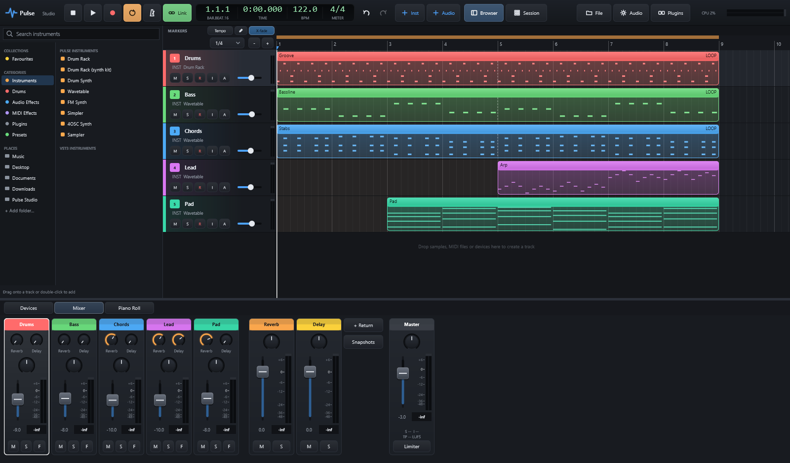

# Pulse Studio

A native Windows DAW built with C++, [JUCE](https://juce.com) and [Tracktion Engine](https://github.com/Tracktion/tracktion_engine). It hosts VST3 plugins, runs on ASIO audio interfaces and supports Ableton Push 2.



## Install

Run `dist/PulseStudio-0.35.0-Setup.exe`. It installs for your user only (no admin needed) or for all users, and adds a Start-menu entry and an optional desktop shortcut.

## Build

You need Visual Studio 2022 Build Tools (C++ workload) and CMake. Then:

```bash
cmake -S . -B build -G "Visual Studio 17 2022" -A x64
cmake --build build --config Release --parallel
```

The app is built to `build/PulseStudio_artefacts/Release/Pulse Studio.exe`. The first build compiles JUCE and Tracktion Engine, so it takes a few minutes. Later builds only recompile `Source/`.

To build the installer, use [Inno Setup 6](https://jrsoftware.org/isinfo.php):

```bash
ISCC.exe installer\PulseStudio.iss
```

The installer is written to `dist/`. Add `/DBuildDir=..\build-dev` to package a different build folder.

## First run

**Built-in sounds:** the first time Pulse runs it renders a sound library from its own synths (about a second, nothing is downloaded) into *Documents/Pulse Studio/Factory Sounds*, which appears under *Places* in the browser: one-shots for five kit styles (Classic, 808, 909, Lo-fi, Electro), six two-bar drum loops (House, Hip Hop, Breakbeat, Techno, Trap, Electro) and multisampled Keys, Bass, Pad, Pluck, Bell and Organ. A new Simpler starts with the Keys multisample (a Simpler preset picks a matching one), *Drum Rack (sampled kit)* in the browser loads a sampled kit, and the Drum Rack's kit menu has *Load sampled kit*.

**Colour themes:** *Audio* (settings) → *Appearance* shows 20 themes as preview cards: Pulse Dark, Midnight Blue, Graphite, Studio Grey, OLED Black, Nord, Dracula, Solarized Dark, Monokai, Gruvbox, Synthwave, Forest, Ocean, Ember, Rose Pine, Cyber Lime, High Contrast, and the light themes Daylight, Paper and Solarized Light. Click one and it applies right away (and is remembered). The command palette has *Colour theme...* and *Next colour theme*.

A small splash shows while Pulse starts: opening the audio interface can take a couple of seconds with some drivers. Each start writes its timings to *%TEMP%/pulse-startup.log*.

- **Welcome screen:** at startup (turn it off with *Show this at startup*, reopen it from *File → Welcome screen...*): your recent projects, new project (empty, demo song or one of your templates), open, and the main shortcuts.

1. **Audio Settings → Audio / MIDI**: pick your interface. Choose **ASIO** for the lowest latency, then set the buffer size.
2. **Audio Settings → Recording**: set the count-in, MIDI overdub and a per-input recording offset.
3. **Plugins**: click *Options → Scan for new or updated VST3 plugins*. Scanning runs in a separate process, so a crashing plugin is skipped instead of taking the app down.
4. Press **Space** to play the demo song.

Projects are saved as `.tracktionedit` files in `Documents/Pulse Studio/`. Presets go in `Documents/Pulse Studio/Presets/`, and bounces in a `Bounces` folder next to the project.

## Features

### Arrangement
- **Levels everywhere:** every track header has a stereo meter, the session view has a meter and mini mixer (volume, mute, solo, arm) under each column, the top bar shows the master level, and mixer strips have meters with a dB scale and a peak readout (click it to reset). A meter's top light turns red after clipping until you click it.
- **Drag and drop:** drag a track header up or down to reorder tracks (a blue line shows where it lands). Drag a device by its header to reorder the chain, or drop it on a track header to move it to that track (**Ctrl** copies; a copied Drum Rack gets its own pads). Browser devices dropped in the chain land where you drop them. In the session view, drag a clip to another slot (**Ctrl** copies), and right-click a scene to rename it.
- **Track colours and numbers:** click a track's colour strip or number (or right-click → *Colour...*) for a 32-colour palette; it applies to every selected track, and clips follow their track's colour. Double-click a name to rename it.
- **Tracks:** instrument, audio and **group** tracks. Select tracks with Ctrl-click, then press Ctrl+G to group them into a submix; ▾ collapses a group.
- **Selection:** drag on empty lane space for a **rubber band** (Shift adds to the selection), or Ctrl/Shift-click clips. Selected clips move together.
- **Editing:** cut, copy and paste at the playhead (Ctrl+X/C/V), duplicate (Ctrl+D), **split at the playhead** (Ctrl+E), select all (Ctrl+A).
- **Loop-range edits:** right-click the ruler to duplicate the region, insert silence, delete time (closing the gap), or bounce the region.
- **Render:** right-click a track header to **freeze/unfreeze**, **flatten** (replace with audio), or **bounce to a new audio track**. Ctrl+J bounces the selected clips' range.
- **Automation:** the **A** button opens a lane for any parameter. Click to add points and drag to move them; right-click removes one.
  - **Alt-drag a line** to bend it into a curve.
  - The **pencil** (toolbar, or **D**) draws automation by dragging. Points land on the grid, so you get steps at the snap size.
- **Modulators:** *+ Modulator* in the device chain adds an LFO, step sequencer, envelope follower, random, MIDI tracker or breakpoint envelope to the track. Right-click any device knob → *Modulate with* to connect one, with an amount from -100% to +100%. Modulated knobs show a purple dot that moves with the modulation.
- **Clip envelopes:** in the piano roll, set the lane menu to *Device envelope...* and pick any parameter of the track's devices, then draw. The envelope lives in the clip, so it plays wherever the clip plays, including looped and session clips.
- **Audio clips:** drag the fade handles; double-click for gain, pitch, fades, reverse and **warp to tempo**.
- **Markers:** the strip above the ruler holds song markers (verse, chorus...).
  - Double-click the strip or press **Ctrl+K** to add one at the playhead.
  - Click a marker to jump to it, drag to move it, and double-click to rename it.
  - **Ctrl+←/→** jumps to the previous or next marker.
- **Tempo and time signature changes:**
  - **Tempo** (above the track headers) opens the tempo lane: double-click to add a tempo change, drag points up or down (BPM) and sideways (position), and right-click to delete one.
  - Right-click the marker strip to add a time signature (e.g. 3/4, 7/8) at that bar.
  - The ruler, grid and LCD follow both.
- **Takes and comping:**
  - Loop-recorded MIDI takes appear under right-click → *Takes*.
  - For audio, select several recorded passes and choose *Combine into takes*.
  - Then use the track menu → *Show take lanes*. Each take gets a row under the clip. Click a take to use it for the whole clip, or drag across part of it to use that take for just that range: the clip is split there.
- **Crossfades:** overlapping audio clips crossfade automatically (the **X-fade** button toggles this). Moving them apart removes the fades again.
- **Keyboard editing:** the arrow keys move the selected clips. ←/→ move by the grid (Shift = 1 bar) and ↑/↓ move them to the track above or below. **Z** zooms to the selection (Shift+Z = whole song), **+**/**−** zoom, and **Ctrl+L** loops the selection.
- **Clip looping:** right-click a MIDI or audio clip → *Loop clip*, then drag the right edge (or use *Clip length*) to repeat it. For example, loop a 1-bar clip across 8 bars. *Loop length* sets the looped region; dashed lines mark each repeat.
- **Warp markers** (audio): right-click → *Warp markers*. Double-click the strip at the bottom of the clip to add a marker, drag markers to move audio onto the beat (Alt = no snap), and right-click a marker to delete it. You can also add markers at the playhead or at every detected transient.

- **Piano roll tools:** **Draw** (or **B**) paints a note on every grid step you drag across. **Alt-drag** notes to copy them (the originals stay). **Ghosts** shows other clips' notes faintly behind yours, so parts fit together. A coloured bar along each note's bottom shows its velocity (green soft, red hard).
- **Lane heights:** drag the bottom edge of a track header to make that track taller or shorter (double-click the edge to reset). Short tracks show a compact header with name, mute and solo.
- **Clips:** double-click a clip's name bar to rename it.
- **Instrument shortcut:** click the instrument name under a track's name (e.g. *INST Wavetable*) to open that instrument.
- **Piano roll note entry:** click to add a note one grid step long (1/16 grid = a 1/16 note), or keep dragging right to draw it longer in grid steps. Grab either end of a note to resize it (the right end changes the length, the left end the start); the edges are easy to catch even on short notes.
- **Track names:** a device dropped from the browser names its new track in plain words (*Drums* for Drum Rack, Drum Rack kits and Drum Synth, *Wavetable*, a preset's name, a chain's file name). Until you rename it yourself, such a track follows its instrument: swap the instrument and the name changes with it. Projects from older versions get their raw names (like *pulseDrumSynth*) fixed when they open.
- **Returns and master in the arrangement:** a slim row for every return track and the master sits under the tracks. Click a row to open its devices, set its volume, show an automation lane (**A**: any device parameter of that return or the master, or the fader), drop devices on it (or click **+**), and see its devices as chips: double-click a chip to open the device, drag it to move it (Ctrl copies), right-click to bypass or delete. Right-click a return's row to rename or delete it. Older projects' basic reverb / delay returns are swapped for Pulse Reverb / Delay (settings carried over) when they open.
### Audio tools (right-click an audio clip)
- **Clip properties** (double-click an audio clip): a **gain envelope** over the waveform (click the yellow line to add a point, drag points, double-click to delete; *Clear* removes it — the original file is never changed), clip gain, pitch, and fades with their **shape** (linear, fast, slow, S-curve).
- **Slip editing:** **Alt**+drag inside an audio clip moves the audio within the clip without moving the clip.
- **Extract groove:** right-click a clip (MIDI or audio) → *Extract groove* measures how early or late its hits land on each 16th and adds that feel to the groove list, ready to apply to any MIDI clip (*Groove* menu).
- **Edit audio (sample editor):** a zoomable waveform window. Drag to select (double-click or Ctrl+A selects everything), then Cut (Delete), Silence, Normalise, Fade in/out, Reverse or ±3 dB. It has its own undo (Ctrl+Z). *Apply* writes a new file to `Edited Audio` next to the project and points the clip at it. The original file is never changed, and the whole edit can be undone in the project.
- **Slice to Drum Rack (at transients):** cuts the clip at its transients into up to 64 slices. Each slice goes on a pad of a new Drum Rack track, and a MIDI clip plays the slices back in the original rhythm.
- **Warp mode:** picks the time-stretch algorithm for the clip: SoundTouch (Normal / Better) or Signalsmith (Default / Cheaper).
- **Convert to new MIDI track:** puts a new track under the clip with a MIDI clip lined up to the audio.
  - **Drums:** onsets become kick, snare and hi-hat notes on a Drum Rack.
  - **Melody:** monophonic pitch tracking, played by a Wavetable synth.
  - **Harmony:** chords and polyphony, played by a Wavetable synth.
- **Separate stems (Demucs):** splits the clip into drums, bass, vocals and other with Meta's open-source Demucs model. The stems arrive as a group of four tracks lined up with the clip, and the original clip is muted.
  - The first use offers a one-time setup: a private Python environment with PyTorch (CPU) and Demucs, about 1.5 GB, in `Documents/Pulse Studio/Tools/stems-env`. Your system Python is left alone. It needs Python 3.9-3.12 from python.org.
  - The first separation downloads the model (about 80 MB).
  - Expect roughly 1-2× the song's length on a typical CPU.
- **ARA (Melodyne, etc.):** *ARA → Edit with …* hands the clip to an ARA plugin, and double-clicking the clip opens its editor. Edits are saved with the project, and *Stop using ARA* returns to normal playback. ARA plugins appear after a VST3 rescan (*Plugins → Options → Scan*).

### Session view (Tab)
- **Arrangement record:** turn on *Arrangement record* in the session toolbar and play: every clip you launch is written into the arrangement where it played (looped for as long as it ran).
- **Scene tempo:** right-click a scene → *Set tempo...*: launching the scene changes the tempo (shown next to its name). *Rename...* and *Clear tempo* are there too.
- **Launch quantisation per clip:** right-click a clip slot → *Launch quantisation* (or leave it on *Global*).
- An Ableton-style clip launcher with scenes and launch quantisation. Clips loop until stopped.
- **Session recording:** on an armed track, click an empty slot (shown with a red dot) to record a new clip into it. Right-click any empty slot → *Record into this slot*.
- *Back to arrangement* (or a track's **Arr** button) hands tracks back to the timeline.
- **Follow actions:** right-click a clip → *Follow action* to choose what happens after it has played for N loops or bars: next, previous, first, last, any, other, round robin, play again or stop. Add a *second action* with a chance (e.g. 75% next / 25% any) for generative arrangements. A ↪ marks clips that have one.

### Ableton Link
Click **Link** in the transport bar to join a Link session with other apps and devices on your network (Ableton Live, Traktor, phone apps and so on).
- Tempo changes go both ways.
- Bars line up: playback is nudged to stay in phase.
- Start/stop is shared.

The button's tooltip shows how many peers are connected. The first time you turn it on, Windows may ask whether Pulse Studio can use the network. Allow private networks.

### Ableton Push 2
- **Your own encoder layout:** right-click any device knob → *Assign to Push encoder* → 1-8. In Device mode those encoders control your picks first (per track, saved with the project).
- **Parameter banks:** in Device mode, **Shift + Page < >** steps through the device's parameters eight at a time.
- **Drum banks:** on a Drum Rack track, **Octave up / down** shows the next or previous 16 pads.
Plug it in and it connects automatically (hot-plug supported). The Push's area is outlined in red in the session view, and **PUSH** appears next to the CPU meter, whose tooltip shows the current mode.

| Control | Action |
| --- | --- |
| **Session** button | 8×8 grid = clips. A pad launches a clip; on an armed track an empty pad records into the slot; otherwise it stops the track. Hold **Delete** + pad deletes a clip. |
| Scene buttons (right column) | Launch scenes |
| Upper row | Session: stop the track. Device mode: pick the device |
| Lower row | Select a track (and route MIDI to it) |
| Arrows | Move the 8×8 bank (Shift = 8 at a time). Note mode: ←/→ selects the track, ↑/↓ changes octave |
| **Note** button | Play the selected track: in-key 4ths layout, or a 4×4 **drum layout** for Drum Rack tracks. Velocity, aftertouch and the touch strip (pitch bend) are passed through. |
| Octave ↑/↓, **Scale** | Octave; cycle the scale (Shift + Scale = root note) |
| **Device** / **Mix** | Encoders control the selected device's parameters (Page ◀ ▶ changes device), or the bank's volume → pan → send A → send B (press Mix again to cycle) |
| Tempo / master encoders | Tempo (Shift = fine) / master volume |
| **Layout** (drum tracks, Note mode) | **Step sequencer**: the top 4 rows are 32 sixteenth-note steps for the selected drum (tap to add or remove), the bottom-left 4×4 plays and selects drums, and the bottom-right 4×4 picks 2-bar pages. Pressing a page past the end lengthens the clip. Steps go into the selected clip, else the clip under the playhead, else a new 2-bar clip. |
| Play, Record, Metronome, Undo (Shift = redo), Duplicate, Quantize, Tap Tempo, Mute, Solo, Browse, Clip | What you'd expect |

**Display:** the Push screen shows the eight encoder values (device parameters or the mix) with arcs, plus the upper-button functions, track names and the current mode. The display uses USB through libusb and needs the Push 2's WinUSB driver. That driver installs with Ableton Live, or Windows installs it automatically on most systems. The PUSH status tooltip says whether the display is connected.

### Controllers and MIDI
- **MIDI Learn:** right-click any knob, fader or pan → *MIDI Learn...*, then move a control on your hardware (Esc cancels). Mappings are saved in the project; an orange dot marks mapped knobs.
- The selected track automatically receives live input from every connected MIDI controller.
- **Piano roll** controller lanes: velocity, pitch bend, mod wheel, volume, pan, expression and sustain.
- **Scales in the piano roll:** pick a scale and root to shade out-of-key rows (the root rows are tinted). **Fold** shows only in-key rows, or only the rows with notes when no scale is chosen. Dragging notes up or down then stays in key.
- **MIDI effects** (*+ Add device → MIDI Effects*, or the browser) sit in front of the instrument:
  - **Arpeggiator:** up, down, up/down, as played, random or chord. Rate is 1/4-1/32 or triplets, over 1-4 octaves, with gate and velocity. It locks to the song grid while playing.
  - **Chord:** up to four added intervals.
  - **Scale:** snaps everything to a key, with transpose.
  - **Note Echo:** tempo-synced MIDI echoes with velocity feedback and a pitch step.
- **MPE:** the Wavetable synth responds per note to pitch bend (Bend Range up to 48 semitones), pressure (cutoff and level) and slide/CC74 (wavetable position). It also takes poly aftertouch from Push 2 pads.

### Instruments and effects
Pulse's own devices have compact cards: knobs stack in as many rows as the device panel's height allows (drag the divider above the panel up for more), and big devices put their sections on pages with tabs (e.g. FM Synth: *Global*, *Op 1*-*Op 4*). Each card has a collapse arrow (fold it to a slim strip), an **A/B** button to compare two versions of its settings, and in its ☰ menu *Randomise* (levels are left alone), *Randomise a little*, *Reset to defaults*, *Copy settings* and *Paste settings*. Cards have labelled sections and a live display that follows the page you're on.
- **Big editor window:** click a Pulse device's edit button (or double-click its card) to open it in its own resizable window. Its header has *Presets* (factory presets, your saved presets and *Save preset...*), **A/B** compare, *Randomise*, *Reset* and *Fold all*. It has large graphs with frequency, dB and time scales (for example, Wavetable shows both oscillators' wavetable frames, the filter curve and both envelopes, and Drum Synth draws its kick, snare, hat and clap with the current settings). Below them are all the controls in sections you can fold, plus *Presets*, *Randomise*, *Reset* and *Fold all*. MIDI effects show what they do to a test phrase (a held chord, then four notes; the result updates as you turn knobs), the Vocoder shows its 16 band levels live, and Utility has a stereo scope with a correlation meter and a width / balance wedge you can drag. Devices without a dedicated graph show every parameter as a bar you can drag. Opening it again brings the window to the front.
- **Graphs you can drag:** every graph is an editor wired to the knobs (with undo; double-click a point to reset it):
  - **Envelopes** (Wavetable amp + filter, Simpler amp + filter, FM operators and filter, Drum Rack pads, Auto Filter's follower): drag the attack peak, the decay / sustain point and the release end.
  - **Filter curves** (Wavetable, Simpler, FM, Drum Rack pads, Auto Filter): drag the point for cutoff (left / right) and resonance (up / down), or scroll for resonance. The shaded band shows how far the filter envelope sweeps.
  - **Glue Compressor / Limiter:** the transfer curve with a threshold point (up / down sets the ratio on the Glue) and a gain-reduction meter.
  - **Saturator** (drag for drive and bias), **Pulse Reverb** (predelay and decay points), **Pulse Delay** (the first repeat sets the time, the second's height the feedback), **EQ Six** (band points).
- **Factory presets:** over 180, at least four for every device: synth leads, basses, pads, keys and textures for Wavetable and FM Synth, playing styles for Simpler, kit characters for Drum Synth, and mixing starting points for every effect (bus compression, rooms, halls and plates, tempo delays, EQ moves, filter movement, saturation, limiting). MIDI effects have them too: arpeggio patterns, chord shapes (triads, sevenths, power chords), scales and echo patterns. Find them in the browser under *Presets* or in a device's ☰ menu.
- **Filter envelopes everywhere:** every instrument filter has its own attack, decay, sustain and release plus an envelope amount (Wavetable, Simpler, FM Synth, Drum Rack pads). Every knob can be automated, MIDI-learned and mapped to a macro. Knobs follow the parameter's natural scale (for example, 1 kHz sits at the middle of a frequency knob).

| Device | What it does |
| --- | --- |
| **Wavetable** | Two wavetable oscillators. There are five table sets (basic shapes, pulse width, harmonics, vowels and sync saw), and **Position** morphs through each set. Also has up to 7-voice unison with detune and stereo spread, a sub oscillator, a 12/24 dB low-pass, band-pass or high-pass filter with its own envelope, an amp envelope, an LFO to position and cutoff, and glide. Tables are band-limited per octave, so high notes don't alias. |
| **Simpler** | A sample instrument (one sample, or a multisample mapped by note names). Drag start, end and loop-start markers on the waveform, and loop with a crossfade. Also has root note, transpose and detune, ADSR, a filter, and velocity, gain and pan. Modes are Classic, One-shot, Mono and **Granular** (grain size, density, spray and a scan position through the sample). Drop a file from the browser or Explorer onto the waveform, or click *Load*. |
| **Prism EQ** | A six-band precision EQ. **Shapes:** bell, low and high shelf, low and high cut, notch, band pass, tilt shelf, all pass and flat tilt. **Slopes** from 6 to 96 dB/oct (cuts, shelves, band pass, tilt). **Placement** per band: stereo, left, right, mid or side. **Dynamic** bands: the gain moves by up to *Range* (boost or cut) when the level around the band goes over *Threshold*, with attack and release (a de-esser, a bass tamer). **Movement**: an LFO (sine, triangle, saw, square, random; free in Hz or synced from 1/16 to 4 bars) or the band's own envelope moves its frequency (up to ±4 octaves) and gain (wah, phaser notches, rhythmic filters). **Solo** a band to hear just its region. *Auto gain* keeps the level steady; *Dry/Wet*, *Output*. **The display:** a pre / post analyser (tilted 4.5 dB/oct so pink noise reads flat), every band's own curve (the selected one filled), the total curve, and while audio plays the live curve and each moving band's current position. Drag a numbered node: left / right = frequency, up / down = gain (on cuts, notch, band pass and all pass up / down = resonance). The diamonds beside the selected node set the bandwidth (Q). **Alt-drag** = Q, **Shift** = fine, **Ctrl** = one direction only, **scroll** = Q (Shift+scroll = gain). Double-click empty space to add a band there, double-click a node to turn it on / off, right-click a node for its shape, slope, placement, dynamic, movement, solo, invert and reset; right-click empty space for the analyser, display range (±3 / 6 / 12 / 30 dB) and auto gain. Hover anywhere to read frequency, note and gain. 15 presets, from vocal clarity and a dynamic de-esser to wah, phaser and mid/side air. |
| **EQ Six** | A 6-band EQ: low and high cut (24 dB/oct), shelves, bells and notch. Drag the numbered nodes on the curve; scroll over a node to change Q, and double-click one to turn it on or off. A live spectrum shows behind the curve. |
| **Glue Compressor** | A bus compressor with stepped attack and release (including Auto), 2:1, 4:1 and 10:1 ratios, a range limit, makeup gain, dry/wet and soft clip. It has a gain-reduction meter. |
| **Saturator** | Seven shapes (analog, tape, tube, hard clip, foldback, sine fold and bit crush) with 4× oversampling, bias, a tone tilt and dry/wet. It shows the transfer curve. |
| **Auto Filter** | A low-pass, band-pass, high-pass, notch or 24 dB low-pass filter with drive. The LFO is free-running or tempo-synced (1/16 to 4 bars) with six shapes and a stereo phase offset. An envelope follower and a dry/wet control round it out. |
| **Wavetable: draw your own** | Click *Draw...* on the Wavetable display: draw two single cycles (*Start* and *End*; Position morphs between them) or start from sine, triangle, saw, square or noise, then *Smooth* / *Normalise*. *Use on Osc 1 / 2* switches an oscillator to the **User (drawn)** table. It's band-limited like the built-in tables and saved with the project. |
| **FM Synth** | Four operators (ratio, fine, level and ADSR each) in eight algorithms, shown as a diagram, from a classic 4>3>2>1 stack to fully additive. Feedback on operator 4, a filter, velocity and glide. |
| **Pulse Reverb** | An 8-line feedback delay network with input diffusion: predelay, size, decay (RT60, up to 20 s), damping, low cut, chorus, width, freeze and dry/wet. The display shows the decay. |
| **Pulse Delay** | Tempo-synced (1/32 to 1 bar, dotted and triplets) or free time, feedback with low / high cut, ping-pong, wobble, drive and dry/wet. The display shows the repeats. |
| **Vocoder** | 16 bands. The track's audio (voice) shapes a carrier: another track through the sidechain (*SC*), or an internal saw or noise. Formant shift, attack, release and an unvoiced (noise) blend. |
| **Pitch Correction** | Detects the note and pulls it to the nearest note of a key and scale (or chromatic). *Speed* sets how fast (Instant gives the hard-tuned effect); *Amount* and dry/wet set how much. |
| **Utility** | Gain, stereo width (0-400 %, mid/side), mono, **bass mono** below a set frequency, channel mode (stereo, left, right, swap), phase invert, balance, a DC filter and mute. |
| **Tuner** | A chromatic tuner on any track: the note, its frequency and a cents needle (green when in tune), with a reference pitch (415-466 Hz) and an option to mute the output while tuning. |
| **Spectrum** | A large analyser: log-frequency spectrum with block size (1024-8192), averaging, range and peak hold (double-click to reset). Hover to read the frequency and note. |

**Groove / swing:** right-click a MIDI clip → *Groove* to pick a template (e.g. *Basic 8th Swing*, *Basic 16th Swing*) and an amount. The groove is applied as the clip plays. *Commit groove to notes* moves the notes for real.

### Sound design
- **Drum Rack:** from the *+ Inst* menu, the browser or *+ Add device*. *Drum Rack (synth kit)* starts with a playable synthesised kit.
  - **128 pads**, shown 16 at a time. The strip at the left shows all 128 (filled pads are orange); click or scroll it, or use the arrows, to change the bank. A pad's slot is its note (C1 = kick, like General MIDI).
  - **Pads:** click to play (higher on the pad = louder). Drop samples on a pad; several files fill consecutive pads, and **Shift**+drop adds them as layers. Drag a pad onto another to **move** it (swapping if the target is used), and **Ctrl**+drag to **copy** it. The small **M** / **S** buttons mute and solo. Right-click for load, synth drum, copy / paste, duplicate, choke group, *Extract to new track* and clear.
  - **Sample page:** up to 8 **layers** per pad, each with a velocity range. Layers are picked by velocity, in **round robin**, at random, or by velocity with cycling between matches (*Spread velocity* splits 1-127 evenly). Drag the start / end markers on the waveform, and set reverse, one-shot or gate, transpose and detune.
  - **Shape page:** amp envelope (attack, decay, sustain, release), filter (low / band / high pass) with velocity-to-cutoff, and velocity-to-volume.
  - **Synth page:** any pad can be synthesised instead: kick, snare, closed / open hat, clap, tom, rim, cowbell or cymbal, with tune, length, tone, snap and drive.
  - **Chain page:** the pad's own effects (drop a device from the browser on the pad, or *+ Pad effect*; reorder and bypass them), its mixer (volume, pan, **Send A / B**), its **receive note** (remap which note plays it) and its **choke group** (pads in the same group cut each other off, e.g. open and closed hats).
  - **Mixer page:** volume, pan, sends, mute, solo and a level meter for every pad and both returns.
  - **Returns page:** two return chains inside the rack (for example a reverb on A and a delay on B) fed by the pad sends.
  - **Macros page:** 8 rack macros. Right-click any knob of a pad or pad effect → *Map to Rack Macro*.
  - **Kit menu:** *Load synth kit*, *Randomise kit* (picks kick / snare / hat / clap... samples at random from your browser folders by file name, and synthesises anything it can't find), *Clear all pads*.
  - Drum Racks from earlier versions are upgraded automatically when a project is opened.
- **Factory presets:** every Pulse instrument and effect has presets in its ☰ menu (*Factory presets*), e.g. Wavetable *Supersaw Lead*, *Acid Bass*, *Warm Pad*; FM *E-Piano*, *Bell*; Reverb *Plate*, *Ambient Wash*; Delay *Tape Echo*; Glue *Drum Bus*. They're also in the browser (*Instruments → Sounds*, *Audio Effects → Effect presets*, *Presets*), ready to drag onto a track.
- **Drum kits:** Drum Rack *Kit → Load synth kit* comes in Classic, 808, 909, Lo-fi and Electro flavours; the Drum Synth has the same kits as presets.
- **Project templates:** *New Project* (and the welcome screen) offers factory templates — House, Hip-Hop, Ambient and Empty with returns — as well as your own.
- **Drum Synth:** a synthesised drum kit as an instrument. In *GM kit* mode notes play kick (C1), snare (D1), hats (F#1 / A#1), toms, clap, cymbals and cowbell, or pick one drum to play chromatically.
- **Simpler multisample:** drop several samples on Simpler (or right-click → *Load multisample*). They are mapped across the keyboard by the note names in the file names (*Piano C3.wav*, *Strings_A#2.wav*, *vln_60.wav*), and the key map shows under the waveform.
- **Presets:**
  - **Track presets:** right-click a track header → *Save track preset*. This saves the instrument, effects (Drum Rack samples included) and mixer settings, but no clips. Saved presets appear under *Track presets* in the browser's Devices tab; drag one into the arrangement, or double-click it, to create a new track.
  - **Device presets:** the ☰ button on any device saves and loads its full state (VST3s included).
  - **Chain presets:** saves and loads the whole device chain. Chain presets also appear in the browser, so you can drag one onto a track.
- **Macros:** 8 per track. Right-click any device knob → *Map to Macro*; a blue dot marks mapped knobs.
- **Browser layout:** a sidebar with *Collections* (Favourites), *Categories* (Instruments, Drums, Audio Effects, MIDI Effects, Plugins, Presets) and *Places* (your folders; *+ Add folder...*, right-click to remove one). The search box at the top filters whatever is shown: devices by name in a category, or files in a place and all its sub-folders.
- **MIDI tools** (piano roll → *Tools*, on the selected notes or the whole clip): humanize (light / medium / heavy), legato, strum chords up or down, fit to scale (uses the scale chosen in the piano roll), velocity (louder, softer, compress, all 100, crescendo, decrescendo, randomise), reverse, invert, double / half speed.
- **Audio quantize:** right-click an audio clip → *Warp* → *Quantize audio* pulls the transients onto the 1/16, 1/8 or 1/4 grid (100 %, or 50 % to keep some feel) with warp markers, so you can still adjust them by hand.
- **MIDI recording modes:** right-click the record button: *Overdub* (merge into the clip), *New take on every loop pass* (pick takes from the clip's *Takes* menu) or *Replace*.
- **Piano roll:** notes are drawn in the track colour, darker for softer velocities, with their names when there's room; velocities show as lollipops. On a Drum Rack track the keyboard shows the pad names.
- **Browser:** files with preview, plus **Sync**. While the song plays, loops are time-stretched to the project tempo and start on the next bar. Tempo is detected from the file's tag, "120bpm" in the name, or the loop length.
  - **Search:** type in the box under the place list to search the place and all its sub-folders (every word must appear in the file name, in any order; Esc clears). Results can be previewed and dragged like the folder tree.
  - **Favourites:** right-click a file → *Add to favourites*. The *★ Favourites* place lists them (the search box filters it too).

### Mixer and routing
- **EQ at a glance:** every strip (returns and master too) shows a small curve of its first EQ (Prism EQ or EQ Six). Click it to open that EQ, or to add a Prism EQ when there is none.
- **Sends grid:** *Sends* (beside *+ Return*) shows every track's send to every return as one grid of sliders (double-click = off).
- **Narrow strips:** *Narrow* fits more channels on screen (saved with the project).
- **Folding groups:** the arrow on a group strip folds its tracks away, in the mixer and the arrangement.
- **Loudness:** the master strip shows short-term and integrated loudness (LUFS, EBU R128) and the true peak while the song plays; click it to reset. After an export, Pulse reports the file's loudness and true peak and warns when the peak is above -1 dBTP. Export can normalise to -14, -16 or -9 LUFS.
- **Sidechain:** the Glue Compressor takes a sidechain (*SC* button on its card) with a filter so the lows don't trigger it. Right-click a track header → *Duck this track from (sidechain)* → a track sets up classic pumping in one click.
- **Linked faders:** select several tracks (Ctrl-click headers) and moving one of their faders moves them all by the same amount.
- **Mixer snapshots:** *Snapshots* (under *+ Return*) stores every track's volume, pan, mute, solo and sends under a name, and recalls them later.
- Faders, pan, meters and mute/solo, plus submix strips for groups.
- **Return tracks** with **sends** on every track. The *Reverb* and *Delay* returns use Pulse Reverb and Pulse Delay, so every setting can be changed: click the devices icon on a strip (or double-click the strip) to open its devices. The same works for any channel, the master included, and **sidechain** inputs (the **SC** button on devices that support it).
- **Pre/post-fader sends:** right-click a send knob. Pre-fader sends get an orange label and keep sending when the fader is down, which is useful for headphone mixes and parallel effects.
- **CPU and latency:** each strip shows the CPU its devices use (orange above 30%) and their latency. Pulse compensates automatically, so everything stays in time.
- **Freeze (F):** renders a track to audio and switches off its plugins, to save CPU with heavy VST instruments. Click F again to unfreeze.
- **Master Limiter:** a button on the master strip adds a look-ahead brickwall limiter before the master meter. Its Gain, Ceiling and (auto) Release are in the master device chain, and it's also available as a device on any track.
- **Push 2 Mix mode:** press Mix repeatedly to cycle volume → pan → a send to every return (Shift+Mix goes back).

### Export (File menu)
- **Export audio / stems** (Ctrl+Shift+R):
  - WAV, AIFF, FLAC or OGG; 16/24/32-bit float; 44.1–96 kHz.
  - Normalise to a peak or to **LUFS**.
  - Range: whole song, loop range or the selected clips.
  - **Stems:** one file per track and return.
- Exports run in the **background**. A progress bar with Cancel appears in the transport bar, and you can keep working. Playback waits until the export finishes.
- **Export selection** (Ctrl+Shift+E): exports just the selected clips' time range (or the loop range).
- **Export MIDI** (Ctrl+Shift+M): writes the selected MIDI clips, or every MIDI clip, to a `.mid` file. You get one track per Pulse track with the tempo map, and looped clips are written out in full. A track header's right-click menu exports that track's clips.

### Projects and sharing (File menu)
- **Backups:** every save, and every 5 minutes of unsaved work, writes a timestamped copy to a `<project> Backups` folder next to the project (the newest 20 are kept). *File → Restore backup* opens one as a copy, so your project file is never overwritten.
- **Project as one file:** *File → Export project as .zip...* collects every sample into the project and zips it (project, samples, edited audio); *Open project from .zip...* unpacks one into your projects folder and opens it.
- **Crash reports:** *File → Collect crash reports...* zips them (with system details) onto your Desktop. Nothing is sent anywhere.
- **Updates:** *File → Check for updates...* lets you set an address Pulse checks at startup for a newer version (a small JSON file). It only tells you; it never downloads anything itself. Off until you set it.
- **Open recent:** the last 12 projects you opened (*Clear list* empties it).
- **Collect all and save** copies every sample the project uses into a `<project> Samples` folder next to it, then points the project at the copies. That covers audio clips, audio takes, Simpler and Drum Rack samples. Zip the project folder and it opens on any machine. Missing files are listed.
- **Templates:** *Save as template...* keeps your favourite setup (tracks, devices, routing, returns, even clips). *New Project...* then offers an empty project, the demo song or any of your templates. Templates live in `Documents/Pulse Studio/Templates`.

### Plugins
- **Sandboxed plugins** (running in their own process) open in Pulse's device editor when you double-click their card: every parameter as knobs in groups of 16, *Presets* (save / load your own), **A/B**, *Randomise*, *Reset*, and *Plugin window* for the plugin's own interface (the card's *Edit* button opens that directly).
- **Plugin frame:** a VST plugin's window has a Pulse header above the plugin's own editor: *Presets* (the plugin's programs, plus settings you save yourself, kept in *Documents/Pulse Studio/Presets/Plugin States*), **A/B** to compare two versions, *Randomise* / *Randomise a little* with *Undo randomise*, and *Parameters*: a strip of knobs for every parameter with a search box. The parameters you touched last come first.
- **Background scan:** a few seconds after startup Pulse looks for VST3 plugins it hasn't seen yet (only new files, each one checked in a separate process so a crashing plugin can't take Pulse down). Progress shows in the top bar; click × to stop it. The *Plugins* button has *Plugin manager...*, *Scan for new plugins* and an on / off switch for the startup scan.

### Safety
- **Autosave every minute**, with recovery after a crash.
- **Crash reports:** if Pulse Studio crashes, it saves a log with a stack trace. It also notes which plugin the crash happened in, or which plugin was loading at the time.
- **After a crash:** the next launch offers to *disable that plugin*, start in **safe mode**, or continue. Disabled plugins aren't loaded, but their settings stay in your projects. Re-enable them in **Audio Settings → Safety**, which also opens the crash-log folder.
- **Plugin sandbox:** turn on *Audio Settings → Safety → Run new VST3 plugins in their own process*, or use a device's ☰ menu → *Run in its own process*.
  - Each sandboxed plugin then runs in a helper process. If it crashes, Pulse keeps running: an effect passes audio through, an instrument goes quiet, and its card shows **Restart**.
  - Settings and automation work as usual. *Run inside Pulse* moves a plugin back.
- **Safe mode:** hold **Shift** while starting, or run with `--safe-mode`. No plugins load, and the title bar says so.
- **Per-project view:** zoom, scroll, snap, arrangement/session view, browser, bottom panel, panel size, selected track and collapsed groups are saved in the project. The window size and position are remembered too.
- **Undo:** each knob drag is one undo step, and the Undo/Redo tooltips name the action.

## Workflow
- **Command palette (Ctrl+P):** type to find any command, device ("add saturator"), marker or track, then press Enter.
- **Custom shortcuts:** *File → Keyboard shortcuts*. Select a command, click *Assign*, then press the keys. A key that's already in use moves to the new command.
- **Capture MIDI (Ctrl+Shift+C):** played something good without recording? Capture turns the last two minutes of MIDI keyboard input into a clip on the selected track.
- **Groups:** right-click a group header.
  - *Freeze group* renders the submix to an audio track and mutes the group, to save CPU. *Unfreeze* undoes it.
  - *Flatten group* replaces the group with that audio track.

## Undo history

Right-click the undo or redo button for the last 25 steps (pick one to jump there), or open *Undo history* (Ctrl+Shift+H, or the command palette) for the whole list: click any step to go back or forward to it. Keyboard shortcuts can be changed in *Settings → Shortcuts*.

## Shortcuts

All of these can be changed in *File → Keyboard shortcuts*. New: **Ctrl+P** command palette, **Ctrl+Shift+C** capture MIDI, **Ctrl+T** / **Ctrl+Shift+T** new instrument / audio track, **Ctrl+N** / **Ctrl+O** new / open project.


| Key | Action |
| --- | --- |
| Space | Play/stop |
| Tab | Arrangement ↔ Session |
| B | Show/hide browser |
| R / L / M | Record / Loop / Metronome |
| Home | Return to start |
| Ctrl+Z / Ctrl+Y | Undo / redo |
| Ctrl+S | Save |
| Ctrl+C / X / V | Copy / cut / paste at the playhead |
| Ctrl+D | Duplicate the selected clips |
| Ctrl+E | Split at the playhead |
| Ctrl+A | Select all clips (all notes in the piano roll) |
| Ctrl+G | Group the selected tracks |
| Ctrl+J | Bounce the selected clips' range to a new track |
| ← / → | Move the selected clips by the grid (Shift = 1 bar) |
| ↑ / ↓ | Move the selected clips to the track above / below |
| Z / Shift+Z | Zoom to the selection / whole song |
| + / − | Zoom in / out |
| Ctrl+L | Loop the selected clips |
| Ctrl+K | Add a marker at the playhead |
| Ctrl+← / → | Previous / next marker |
| Ctrl+Shift+R / E / M | Export audio / export selection / export MIDI |
| Delete | Delete the selected clips (or notes in the piano roll) |
| 1 / 2 / 3 | Devices / Mixer / Piano Roll |
| Ctrl+wheel / Shift+wheel | Zoom / scroll the timeline |
| Esc | Cancel MIDI Learn |

## Command line

- `--render out.wav` renders the last project offline and exits.
- `--selftest report.txt` builds a scratch project and runs 176 checks (including a real Demucs separation when it's set up), including an audit of every built-in device, rendering audio to check the results, then writes a pass/fail report. The exit code is the number of failures.
- `--dev-profile` uses separate settings and a separate projects folder, for testing builds without touching your real projects.

## Code layout

All app code is header-only in `Source/` and compiled through `Main.cpp`.

| File | Contents |
| --- | --- |
| `Main.cpp` | App, window, engine setup, out-of-process plugin scanning, command line |
| `MainComponent.h` | Project lifecycle, layout, shortcuts, autosave, demo song, dialogs |
| `TransportBar.h` | Transport, tempo/position, view toggles, file menu, Push status |
| `ArrangementView.h` | Ruler, track and group rows, clips (fades, multi-select), rubber band, drag & drop |
| `AutomationLane.h` | Automation lanes |
| `SessionView.h` | Clip launcher, scenes, session recording |
| `Push2.h` | Ableton Push 2 controller (modes, step sequencer, display drawing) |
| `Push2Display.h`, `Push2Usb.cpp` | Push 2 display over USB (libusb) |
| `LinkSync.h` | Ableton Link session |
| `AudioToMidi.h` | Drum / melody / harmony detection and conversion |
| `Stems.h` | Demucs setup, separation and stem import |
| `Browser.h` | File browser with synced preview, search, favourites and the device list |
| `PianoRoll.h` | MIDI editor and controller lanes |
| `DeviceChain.h` | Device rack: device cards, macros, presets |
| `UtilityDevices.h` | Utility, Tuner and Spectrum devices |
| `DrumRack.h`, `DrumPads.h`, `DrumRackCard.h` | Drum Rack model (pads, routing, move / copy / extract, kits), the pad / pad mixer / Drum Synth devices, and the Drum Rack editor |
| `Presets.h`, `Macros.h`, `MidiLearn.h` | Sound design and controller features |
| `MidiFx.h`, `Scales.h` | MIDI effects (Arpeggiator, Chord, Scale, Note Echo), shared scales |
| `Sandbox.h`, `BackgroundRender.h` | Plugin sandbox (helper process), background exports |
| `Commands.h` | Command registry, command palette, shortcut editor |
| `Modulators.h`, `ClipEnvelopes.h` | Track modulators, clip envelopes |
| `SampleEdit.h`, `SampleEditor.h` | Destructive audio edits, transient slicing, warp modes; the sample editor window |
| `Sharing.h` | Collect All and Save, project templates |
| `Timeline.h` | Markers, tempo / time signature maths, crossfades, comping |
| `EditingOps.h` | Clipboard, split, time edits, bounce/flatten/freeze, grouping |
| `Workflow.h` | Keyboard nudging, clip looping, warp markers, MIDI export, track presets, groove |
| `PulseDevices.h`, `PulseSynths.h` | Pulse's own devices (EQ, Glue, Saturator, Auto Filter, Wavetable, Simpler) |
| `DeviceDisplays.h`, `ParamKnob.h` | Device card displays and knobs |
| `DeviceEditor.h`, `Graphs.h` | Big device editor windows; draggable envelope / filter / dynamics graphs |
| `ExportDialog.h`, `AudioSettings.h` | Export and audio/recording settings |
| `Mixer.h`, `Routing.h` | Mixer strips, sends/returns |
| `ClipImport.h`, `ClipProperties.h` | File import, audio clip panel |
| `CrashGuard.h`, `CrashGuardWin.cpp` | Crash reports, plugin blocklist, safe mode |
| `PluginWindow.h`, `PluginMenu.h` | Plugin windows, task runner, plugin menu |
| `SelfTest.h` | `--selftest` |
| `PulseLookAndFeel.h`, `Icons.h` | Look and feel (Segoe UI, graded controls, menus, tooltips) and vector icons |

## Licensing

Third-party code is fetched into `external/` by `scripts/get-dependencies.ps1`: Tracktion Engine with JUCE, Ableton Link (GPLv2+), libusb (LGPL-2.1) and the ARA SDK (Apache 2.0). Demucs (MIT) and PyTorch (BSD) are installed on demand into their own Python environment and run as a separate process. JUCE (AGPLv3) and Tracktion Engine (GPLv3) are used under their open-source licences, so this project must stay GPL-compatible. Selling a closed-source build would require commercial licences for both.
